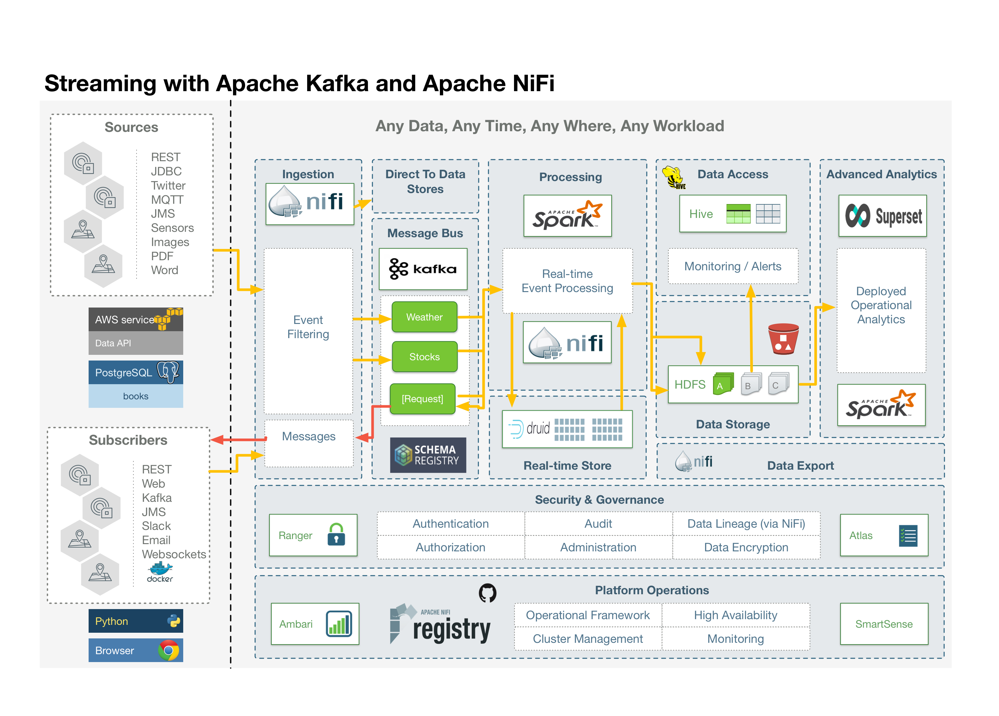

# Prueba de concepto ECO_BI

```docker-compose rm -f && docker-compose build && docker-compose up```

# Platform



# Containers 
|CONTAINER | HOST | Service | PORT    | URL |
|----------|------|---------|---------|-----|
|eco-zookeeper|eco-zookeeper| ADMINSERVER |30001:8080 |http://localhost:30001/commands/|
|eco-zookeeper|eco-zookeeper| ZooKeeper |30002:2181 ||
|eco-zookeeper|eco-zookeeper|  |30003:2888 ||
|eco-zookeeper|eco-zookeeper|  |30004:3888 ||
||||||
|eco-nifi|eco-nifi| ADMINSERVER |30010:8080 |http://localhost:30010/nifi|
|eco-nifi|eco-nifi| ADMINSERVER |30011:8443 |https://localhost:30011/nifi|
|eco-nifi|eco-nifi|  |30012:8082 ||
|eco-nifi|eco-nifi|  |30013:10000 ||


# Stack
## *1. ZooKeeper*
    hostname: eco-zookeeper
    environment:
      - ZOO_CONF_DIR=/conf
      - ZOO_DATA_DIR=/data 
      - ZOO_DATA_LOG_DIR=/datalog 
      - ZOO_LOG_DIR=/logs 
      - ZOO_TICK_TIME=2000 
      - ZOO_INIT_LIMIT=5 
      - ZOO_SYNC_LIMIT=2 
      - ZOO_AUTOPURGE_PURGEINTERVAL=0
      - ZOO_AUTOPURGE_SNAPRETAINCOUNT=3
      - ZOO_MAX_CLIENT_CNXNS=60
      - ZOO_STANDALONE_ENABLED=true
      - ZOO_ADMINSERVER_ENABLED=true
    ports:
      - 30001:8080 # Zookeeper 
      - 30002:2181 # Zookeeper  
      - 30003:2888 
      - 30004:3888 

## *2. NiFi*
    hostname: eco-nifi
    ports:
      - 30010:8080 # Unsecured HTTP Web Port
      - 30011:8443 
      - 30012:8082
      - 30013:10000 
    environment:
      - NIFI_WEB_HTTP_PORT=8080
      - NIFI_CLUSTER_IS_NODE=true
      - NIFI_CLUSTER_NODE_PROTOCOL_PORT=8082
      - NIFI_ZK_CONNECT_STRING=eco-zookeeper:2181
      - NIFI_ELECTION_MAX_WAIT=1 min
    links:
      - eco-zookeeper:eco-zookeeper
    depends_on:
      - eco-zookeeper


